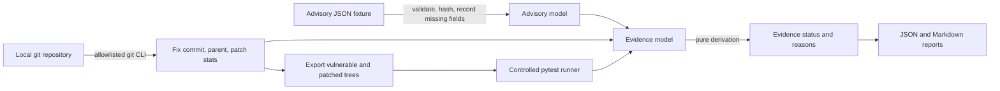

# VulnTrace: Evidence-Driven Vulnerability Analysis and Regression Verification

> **Status: research prototype, Milestone 1.** This repository implements the core evidence model,
> offline fixture ingestion, a controlled regression-test runner, git-based patch analysis, and
> evidence reports, with a synthetic demonstration. The REST API, Streamlit dashboard, real-world
> evaluation dataset, baseline comparison, Docker files, and online advisory import are **not yet
> implemented**. See [Roadmap](#roadmap) and [Known limitations](#known-limitations).

VulnTrace asks whether a published vulnerability fix can be checked with evidence that is linked
together: the advisory, the repository revision, the patch, and the outcome of a regression test on
the vulnerable and patched revisions. It reports what was observed and what remains unknown. It
never declares software secure.

## Research question

Can an evidence-linked pipeline make publicly documented fixes easier to verify than reviewing
advisory metadata alone?

This is a hypothesis to test, not a result. No evaluation on real vulnerability cases has been run
yet (see [docs/methodology.md](docs/methodology.md)).

## Architecture



Source layout:

| Path | Role |
|---|---|
| `src/vulntrace/ingestion/advisory.py` | Normalized advisory schema, offline fixture loader |
| `src/vulntrace/repositories/gitops.py` | Allowlisted git wrapper, safe tree export |
| `src/vulntrace/verification/runner.py` | Approved test execution with timeouts and isolation |
| `src/vulntrace/analysis/evidence.py` | Status enum, transition table, derivation rules |
| `src/vulntrace/analysis/pipeline.py` | End-to-end analysis |
| `src/vulntrace/reporting/report.py` | JSON and Markdown evidence reports |
| `src/vulntrace/security.py` | Input validation, path/URL checks, redaction |
| `src/vulntrace/demo.py`, `scripts/run_demo.py` | Offline synthetic demonstration |

## Evidence statuses

| Status | Meaning |
|---|---|
| `UNKNOWN` | No repository revision could be resolved. |
| `INSUFFICIENT_EVIDENCE` | Evidence exists but does not support a stronger status (for example, the test passes on both revisions). |
| `CANDIDATE_FIX` | A commit is suggested but not explicitly referenced by the advisory. Not produced by this milestone's pipeline. |
| `PATCH_IDENTIFIED` | The advisory explicitly references the fix commit; no test runs were recorded. |
| `TEST_FAILED_ON_VULNERABLE_REVISION` | The approved test fails on the vulnerable revision. |
| `TEST_PASSED_ON_PATCHED_REVISION` | The test passes on the patched revision, with no vulnerable-revision evidence. A pass alone is not a fix. |
| `VERIFIED_FOR_TESTED_CASE` | The test fails on the vulnerable revision and passes on the patched revision in every run. This covers only that test. |

## Installation

Requirements: Python 3.12 or later (tested locally with 3.13), git, and internet access for `pip`.

```bash
git clone vulntrace
cd vulntrace
make install            # creates .venv, installs pinned requirements and the package
source .venv/bin/activate
```

## Offline demonstration

No network access is needed after installation.

```bash
make demo               # or: python scripts/run_demo.py
```

The script builds a temporary git repository with two commits (a vulnerable revision and a patched
revision, tagged `vt-synthetic-fixed`), then runs:

1. **Primary analysis:** the full regression file, three runs per revision. Expected status:
   `VERIFIED_FOR_TESTED_CASE`.
2. **Negative control:** only a test that passes on both revisions. Expected status:
   `INSUFFICIENT_EVIDENCE`.

Reports are written to `results/demo/` (`primary/report.md`, `primary/report.json`, and the same
for `control/`). `results/` is git-ignored except for `.gitkeep`.

Observed output from this repository at the time of writing:

```
VulnTrace synthetic demonstration (offline)
  primary  status: VERIFIED_FOR_TESTED_CASE
           vulnerable runs: ['failed', 'failed', 'failed']
           patched runs:    ['passed', 'passed', 'passed']
  control  status: INSUFFICIENT_EVIDENCE
           selected: ['test_path_guard.py::test_normal_relative_path_allowed']
           vulnerable runs: ['passed', 'passed', 'passed']
```

## Tests and lint

```bash
make lint    # ruff
make test    # pytest: unit, security, integration, regression
```

Last recorded run in this environment: `ruff` passed and `pytest` reported 76 passed. The CI
workflow (`.github/workflows/ci.yml`) runs the same steps on Ubuntu with Python 3.12; that workflow
has not been executed on GitHub yet.

## Example report excerpt

From `results/demo/primary/report.md` (abridged):

```
## Final evidence status
**VERIFIED_FOR_TESTED_CASE**
- The test fails on the vulnerable revision and passes on the patched revision in every run.
  This applies only to the selected test and does not show the software is secure.

## 3. Inferences
- The vulnerable revision `98def68...` is inferred as the first parent of the fix commit.
  It was not checked against affected-version metadata.
```

Reports separate confirmed facts, tool observations, inferences, and missing evidence. They contain
no confidence percentages and no local filesystem paths.

## Dataset provenance

The only dataset is synthetic: `data/fixtures/synthetic_advisory.json` and the three example files
under `examples/`. They were written for this project. They are not real CVE records. SHA-256
hashes are listed in `data/manifests/synthetic_manifest.json`. See
[docs/data_provenance.md](docs/data_provenance.md).

## Security considerations

- Advisory fields, URLs, git refs, file paths and test identifiers are validated before use.
- Git runs through a subcommand allowlist with `shell=False`, hooks disabled and global config
  ignored. Exported trees refuse symlinks and submodules.
- Repository tests run only after explicit approval, only for a top-level `test_*.py` file, in a
  copy of the revision with a minimal environment and a timeout.
- Test subprocess isolation is **not** a security sandbox. Do not run untrusted repositories with
  this tool. See [docs/threat_model.md](docs/threat_model.md).

## Known limitations

- Only the offline synthetic demonstration has been run. No real CVE has been analyzed.
- The vulnerable revision is inferred as the first parent of the fix commit.
- Advisory fixtures are imported from JSON only. Online import is not implemented.
- No REST API, dashboard, SQLite persistence, Docker files or Semgrep integration yet.
- Repeated runs in one environment are expected to agree, so they do not measure flakiness.
- Full list: [docs/limitations.md](docs/limitations.md).

## Research references

Publication details come from Jessy Ayala's CV, which lists work with Professor Joshua Garcia at
UC Irvine. The abstracts and full texts have not yet been read, and DOIs have not been verified.
Listed in [docs/references.md](docs/references.md).

This project is an independent student prototype. It is not affiliated with, endorsed by, or
reproducing the work of UC Irvine or any listed author.

## Roadmap

1. Verify references by reading abstracts and recording DOIs.
2. Add a SQLite schema and a FastAPI layer (`/health`, `/advisories`, `/analyses`, `/analyses/{id}/report`).
3. Add a Streamlit dashboard that shows missing-artifact indicators and uncertainty.
4. Build a manually verified dataset of public cases with inclusion criteria, hashes and provenance.
5. Implement baselines and ablations, and evaluate them on the same cases.
6. Add Docker files, CITATION.cff, and a CI check that runs the demo.

## Citation

No citation is available yet. Until a release is tagged and a paper is written, cite the repository
URL and commit hash.

## License

MIT. See [LICENSE](LICENSE).
